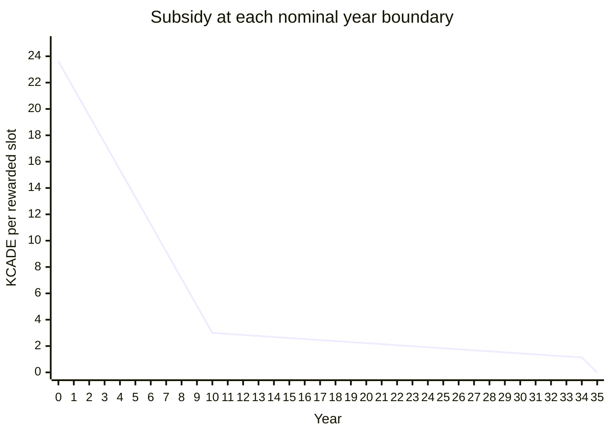
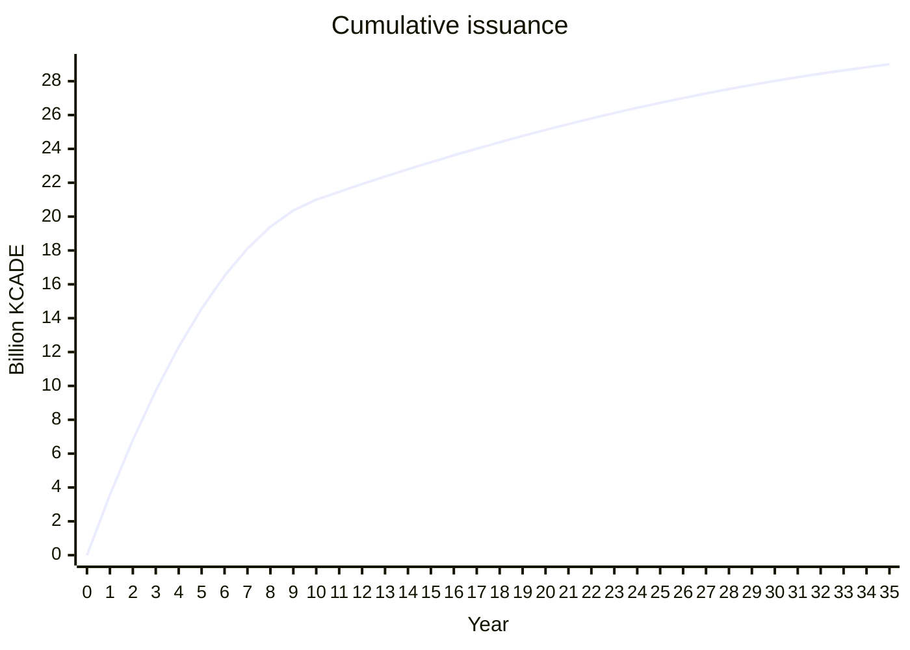

# KASCADE 35-year issuance candidate

The candidate assumes five unique rewarded slots per second, 365.25-day years and zero spendable genesis allocation. It schedules 1,577,880,000 primary slots and 3,944,700,000 tail slots. The repository denomination constant `SOMPI_PER_KASPA` is 100,000,000 Kazmi per KCADE in KASCADE's monetary model. Production has neither selected nor activated this schedule.

| Phase | Budget | Slots | First subsidy | Last subsidy |
| --- | ---: | ---: | ---: | ---: |
| Primary | 21,000,000,000 KCADE | 1,577,880,000 | 23.61799376 | 3.00000000 |
| Tail | 8,000,000,000 KCADE | 3,944,700,000 | 3.00000000 | 1.05607524 |
| Exhausted | 29,000,000,000 KCADE total | 5,522,580,000 completed | 0 | 0 |

## Exact integer construction

Take the midpoint of each nominal slot on each linear phase. The primary runs from 23.6179937638 KCADE to the 3 KCADE join and the tail runs from 3 KCADE to 1.0560752402 KCADE. The endpoints are derived from twice the respective exact budget divided by its slot count, minus the join. Midpoint samples of an affine function sum exactly to the phase budget. Store each reward as a rational with denominator equal to the squared phase length, using `u128` for products and integer division for floor.

Floor every sample, then add one Kazmi to the first 788,939,996 primary slots and first 1,972,350,004 tail slots. Each count is the phase budget minus the sum of floors. The corrections exhaust the budget, with at most one Kazmi of difference from any ideal midpoint. Floors of a decreasing sequence are nonincreasing, and the prefix correction is nonincreasing. The phase join pays exactly 3 KCADE on both sides. The terminal count clamps and every later subsidy is zero. Prefix sums use Euclidean floor-sum in logarithmic time with constant memory. This avoids both multi-billion-entry tables and reward increases from differencing independently rounded cumulative values.

## Issuance by nominal year

The table shows the next slot reward at each boundary; year 35 shows the first unpaid slot. The [CSV](PHASE6_35_YEAR_ISSUANCE.csv) stores all amounts as exact integers.

| Year | Completed slots | Next reward in KCADE | Cumulative KCADE |
| ---: | ---: | ---: | ---: |
| 0 | 0 | 23.61799376 | 0.00000000 |
| 1 | 157788000 | 21.55619439 | 3563972400.78893999 |
| 2 | 315576000 | 19.49439501 | 6802617601.57788001 |
| 3 | 473364000 | 17.43259563 | 9715935602.36682001 |
| 4 | 631152000 | 15.37079626 | 12303926403.15576001 |
| 5 | 788940000 | 13.30899687 | 14566590003.94469998 |
| 6 | 946728000 | 11.24719749 | 16503926403.15575998 |
| 7 | 1104516000 | 9.18539812 | 18115935602.36681998 |
| 8 | 1262304000 | 7.12359874 | 19402617601.57787997 |
| 9 | 1420092000 | 5.06179936 | 20363972400.78893998 |
| 10 | 1577880000 | 3.00000000 | 21000000000.00000000 |
| 11 | 1735668000 | 2.92224301 | 21467229440.78893987 |
| 12 | 1893456000 | 2.84448602 | 21922189761.57787987 |
| 13 | 2051244000 | 2.76672903 | 22364880962.36681996 |
| 14 | 2209032000 | 2.68897204 | 22795303043.15575985 |
| 15 | 2366820000 | 2.61121505 | 23213456003.94469988 |
| 16 | 2524608000 | 2.53345806 | 23619339844.73363991 |
| 17 | 2682396000 | 2.45570107 | 24012954565.52257984 |
| 18 | 2840184000 | 2.37794408 | 24394300166.31151991 |
| 19 | 2997972000 | 2.30018709 | 24763376647.10045990 |
| 20 | 3155760000 | 2.22243010 | 25120184007.88939984 |
| 21 | 3313548000 | 2.14467311 | 25464722248.67833993 |
| 22 | 3471336000 | 2.06691612 | 25796991369.46727987 |
| 23 | 3629124000 | 1.98915912 | 26116991369.46727989 |
| 24 | 3786912000 | 1.91140213 | 26424722248.67834002 |
| 25 | 3944700000 | 1.83364514 | 26720184007.88939989 |
| 26 | 4102488000 | 1.75588815 | 27003376647.10045989 |
| 27 | 4260276000 | 1.67813116 | 27274300166.31151999 |
| 28 | 4418064000 | 1.60037417 | 27532954565.52257990 |
| 29 | 4575852000 | 1.52261718 | 27779339844.73363994 |
| 30 | 4733640000 | 1.44486019 | 28013456003.94469997 |
| 31 | 4891428000 | 1.36710320 | 28235303043.15575988 |
| 32 | 5049216000 | 1.28934621 | 28444880962.36681996 |
| 33 | 5207004000 | 1.21158922 | 28642189761.57787996 |
| 34 | 5364792000 | 1.13383223 | 28827229440.78893990 |
| 35 | 5522580000 | 0.00000000 | 29000000000.00000000 |

## Reward-slot ownership and production gate

- `body_validation_in_context.rs` checks the subsidy in each block's payload against that block's DAA score. DAA scores can skip counts and are not unique across competing tips. Reward payments occur when another block merges an eligible reward source.
- `virtual_processor/utxo_validation.rs` computes ordered mergeset acceptance using the selected parent and its consensus-ordered mergeset. Its `BlockRewardData` is keyed by source block hash. The coinbase builder credits eligible blue and red sources as separate reward claims, and non-DAA red sources may pass fees without subsidy. The accepted coinbase transaction and the source reward claim are distinct events. An accepted transaction index, coinbase ID and DAA score therefore cannot directly serve as a unique reward ordinal.
- The proposal is to assign slots to uniquely credited subsidy claims in deterministic mergeset order, relative to an authenticated selected-parent checkpoint. Verify the exact claim owner and permanent duplicate exclusion, including split/rejoined DAGs and pruning. Persist the counter alongside the accepted reward state, including any accrued entitlement. Roll back and replay from the common parent's committed counter and verify restored counters through IBD and restart. Record fees separately so fee transfers and deferred payouts do not consume another issuance slot. Validate that every recipient output or note is accounted for before committing this state.
- `GENESIS.build_genesis_transactions()` produces a coinbase with no outputs. Its payload includes a nominal subsidy field, which does not itself demonstrate minted value. Confirm genesis treatment, reward eligibility and initial credited allocation for the selected network before activation. Existing allocations or legacy credits must count against the cap.
- Five accepted subsidy claims per second is a projection. Measure claim throughput during parallel mining, initial sync, reorg and partition recovery. Five generated blocks per second does not establish five uniquely credited slots per second. Keep distribution, KRN fallback and any deferred developer accounting separate from the schedule.
- Candidate tests cover exact budgets, boundary vectors, floor-sum versus direct enumeration on small cases, monotonicity controls and branch replay arithmetic. They do not establish end-to-end issuance or prove mergeset ownership. The next implementation gate is a production-path fixture that enumerates ordered credited claims across a competing-tip reorg and an authenticated persistent reopen.

Production supply-cap enforcement is open. Historical 23B recommendations are superseded by the 29B policy. The candidate is exposed only to unit tests and the existing Phase 6 preview build, with no coinbase, network or RPC consumer.
